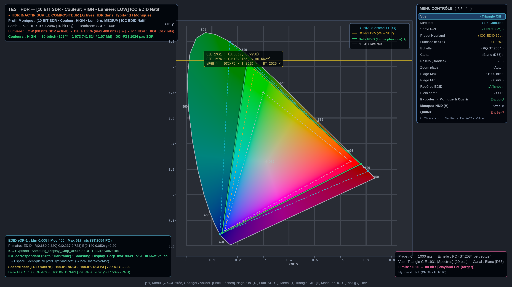

# TEST_HDR (`v0.5`)

Outil natif Wayland / Hyprland (**SDL3 GPU + Vulkan SPIR-V + Pango/Cairo + LittleCMS2**) pour tester l'affichage **HDR / Wide Gamut / 10-bit SDR**, inspecter la luminance en **nits (`cd/m²`)**, visualiser le **triangle chromatique CIE 1931** avec limites physiques EDID, générer **5 profils ICC v4.3 calibrés** et les synchroniser **1-à-1 avec Monique**.



---

## Installation & Autocompilation sur Omarchy (v0.5)

### Installation automatique en une commande (Omarchy)

Télécharge, vérifie les dépendances (`omarchy-pkg-add`), vérifie/propose **Monique** (uniquement sous Omarchy), compile (`CMake` + tests `CTest`) et installe le paquet Arch (`makepkg` + entrée lanceur `TEST_HDR`) :

```bash
curl -fsSL https://raw.githubusercontent.com/vedix95/TEST_HDR/main/install.sh | bash
```

### Depuis les sources (`git clone`)

```bash
git clone https://github.com/vedix95/TEST_HDR.git
cd TEST_HDR
./install.sh
```

Ou pour compiler/lancer sans installer le paquet système :

```bash
./bin/build   # Compile testhdr + exécute les tests unitaires (CTest)
./bin/run     # Compile si nécessaire puis lance testhdr
./bin/install # Compile et installe le paquet via pkgbuild/PKGBUILD
```

Une fois installé, lancez `testhdr` dans un terminal ou **TEST_HDR** depuis le lanceur Omarchy (`Super + Space`).

---

## Vérification Monique au démarrage (Omarchy uniquement)

Avant d'ouvrir la fenêtre principale, `testhdr` vérifie automatiquement si **Monique** (`monique` + module Python `monique`) est installé et intégré :
- **Sous Omarchy** (`ID=omarchy` dans `/etc/os-release` ou présence de `omarchy-pkg-aur-add`) : si Monique est absent, le programme propose de l'installer immédiatement (prompt `[O/n]` en terminal, ou boîte de dialogue graphique depuis le lanceur Omarchy).
- **Hors Omarchy** : aucune installation n'est proposée ; les modes visuels, mires, triangle CIE et lecture EDID fonctionnent normalement et l'export vers Monique est simplement désactivé.

---

## Fonctionnalités (v0.5)

- **4 modes de sortie GPU natifs** (`[M]`) :
  - **HDR10 ST.2084 (10-bit PQ)** — luminance absolue de `0` à `10 000 nits` (`BT.2020 + PQ`).
  - **HDR Extended Linear (16-bit scRGB)** — virgule flottante linéaire (`1.0 = 80 nits`).
  - **SDR 10-bit (linéaire 16F → 10-bit)** — sortie linéaire 16-bit quantifiée sur `10-bit` SDR.
  - **SDR 8-bit (sRGB)** — référence sRGB 8-bit classique.
- **Triangle CIE 1931 & Limites de spectres** (`[T]` ou `--cie`) :
  - Locus spectral `380–700 nm`, triangles **sRGB / Rec.709**, **DCI-P3 D65**, **Dalle EDID physique** et **BT.2020**.
  - Calcul exact de couverture surfacique (`%`) et inspecteur souris `(x, y)` / `(u', v')`.
- **6 Vues & 6 Mires de calibration haute précision** (`[V]`, `[I]` / `Espace`) :
  - `Mixte`, `Continu`, `Bandes discrètes` (12 à 128 paliers), `Canaux RGBW`, `Mires` (Gamuts + ColorChecker, Banding 10-bit vs 8-bit, Clipping Noirs/Blancs, Scène HDR/WCG, Netteté 1px/4:4:4/ANSI, Spectre Teinte × Saturation), `Triangle CIE 1931`.
- **Échelles** (`[S]`) : `PQ (ST.2084)`, `Log10`, `Linéaire`.
- **Détection EDID DRM automatique** : lit `/sys/class/drm/card*-*/edid` (`EDID Min`, `EDID Moy`, `EDID Max`, primaires RGB + point blanc + gamma).
- **Génération & Export ICC 1-à-1 avec Monique** (`[G]`) :
  - Génère **5 profils ICC v4.3** (`EDID-Native`, `DCI-P3-D65`, `sRGB-Calibrated`, `BT2020-Linear`, `BT2020-PQ`) dans `~/.local/share/icc/` et les copie automatiquement vers `~/.local/share/color/icc/`, `~/.local/share/krita/profiles/` et `~/.config/darktable/color/out/`.
  - Crée les **5 profils ICC correspondants dans Monique** (plus les presets Hyprland), sélectionne le profil cohérent avec le test actif, ouvre Monique et ferme `testhdr`.
- **HUD 4 coins + Menu interactif en haut à droite** : pilotable entièrement aux **flèches directionnelles** (`↑/↓/←/→/Entrée`) ou à la **souris**.

---

## Options CLI

```text
testhdr [options]
  --windowed, -w       Démarre en mode fenêtré
  --hdr                Active cm=hdr dans Hyprland via Monique au démarrage
  --cie                Ouvre directement sur le Triangle CIE 1931
  --view <vue>         Vue initiale : mixte, continu, bandes, rgbw, mires, cie
  --sync-profiles      Génère les 5 ICC, synchronise Monique (1-à-1) puis quitte
  --max-nits <valeur>  Définit la borne haute initiale en nits (ex: 617, 1000, 4000)
  --connector <nom>    Force un connecteur DRM (ex: eDP-1, DP-1)
  --version, -v        Affiche la version
  --help, -h           Affiche l'aide
```

---

## Raccourcis clavier

| Touche | Action |
|---|---|
| `↑` / `↓` / `←` / `→` / `Entrée` | Naviguer et modifier le menu HUD en haut à droite (`Shift` pour régler Min/Max nits) |
| `S` | Changer d'échelle (`PQ` / `Log` / `Linéaire`) |
| `V` | Changer de vue (`Mixte` / `Continu` / `Bandes` / `RGBW` / `Mires` / `Triangle CIE`) |
| `I` / `Espace` | Ouvrir / parcourir les 6 mires et images de test (`Shift` pour reculer) |
| `T` | Basculer le triangle des couleurs **CIE 1931** |
| `C` | Changer de canal (`Blanc` / `Rouge` / `Vert` / `Bleu`) |
| `M` | Basculer la sortie GPU (`HDR10 PQ` / `scRGB` / `SDR 10-bit` / `SDR 8-bit`) |
| `P` | Parcourir les presets Monique/Hyprland |
| `G` | Exporter vers Monique (synchronise les profils, sélectionne le mode actif, ouvre Monique et ferme `testhdr`) |
| `L` | Cadrer la plage sur la limite du mode actif |
| `Z` | Parcourir les plages de zoom |
| `N` | Changer le nombre de paliers (12 / 20 / 32 / 64 / 128) |
| `E` | Afficher / masquer les repères EDID |
| `+` / `-` | Ajuster la luminosité matérielle de la dalle (`brightnessctl`, uniquement en SDR, `Ctrl` pour pas 1%) |
| `[` / `]` | Baisser / monter la luminosité du HUD (`10` à `250 nits`) |
| `H` | Masquer / afficher le HUD et la règle |
| `F` / `F11` | Plein écran / fenêtré |
| `R` | Réinitialiser |
| `Esc` / `Q` | Quitter |

---

## Dépendances

- **Runtime :** `sdl3`, `pango`, `cairo`, `wayland`, `lcms2`, `python`, `brightnessctl`, et `monique` *(proposé automatiquement à l'installation sous Omarchy)*
- **Compilation :** `cmake >= 3.20`, `gcc` (C++20), `pkgconf`, `shaderc` (`glslc`), `wayland-protocols` (`wayland-scanner`)

## Licence

[MIT](LICENSE)
